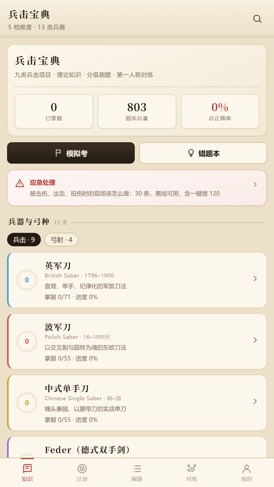
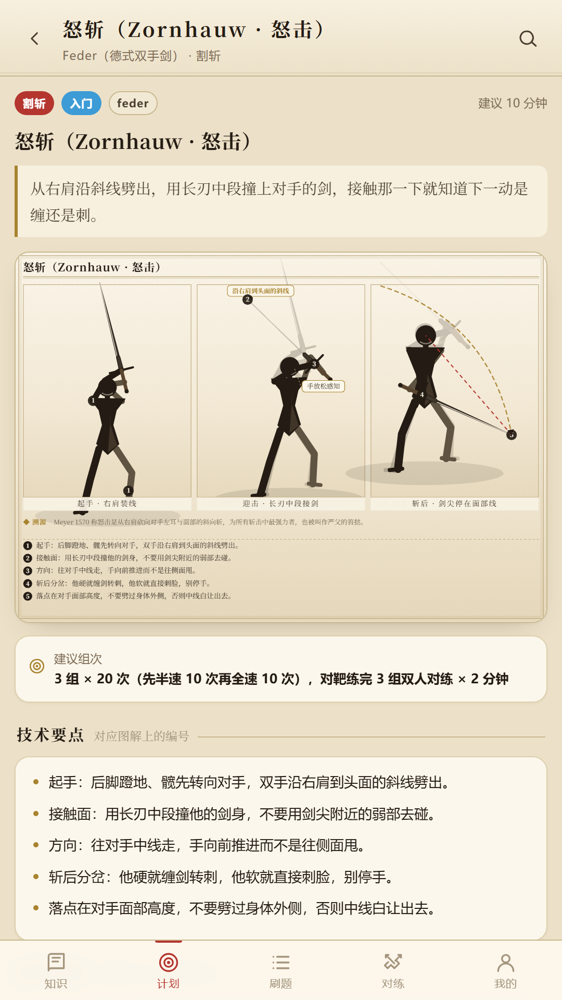
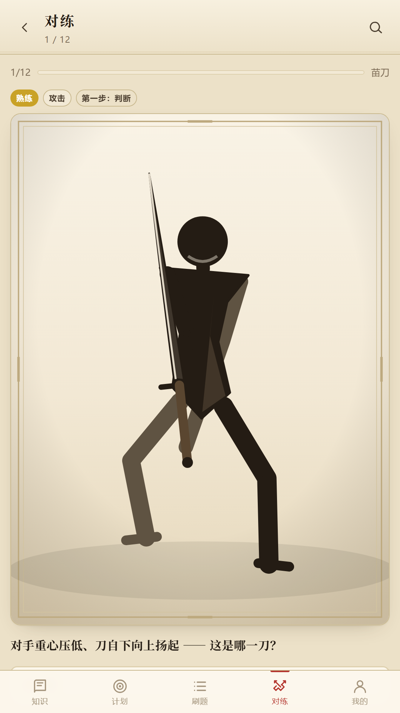
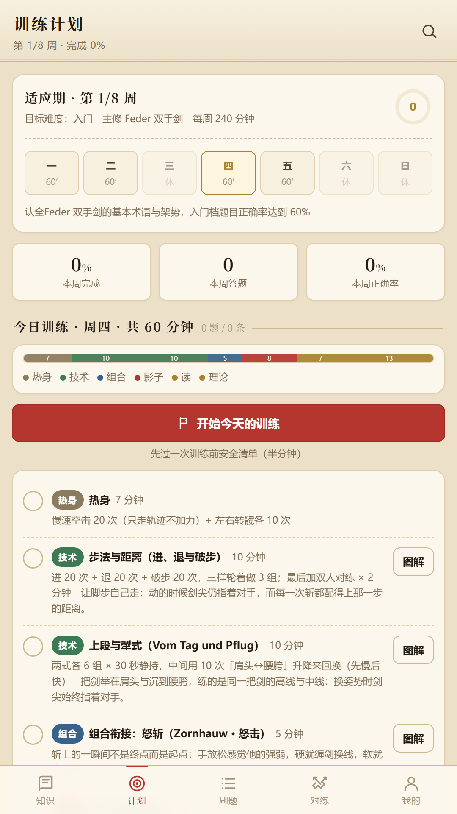

# 兵击宝典

**兵击与射箭 · 理论 · 图解 · 训练计划**

一个完全离线的安卓应用：不注册账号、不收集任何个人信息、不集成任何第三方 SDK。

[**⬇ 下载 APK（V1.2.0）**](https://github.com/BoyevayaMashinaPodderzhkiTankov/-bingji-baodian-/releases/latest/download/bingji-baodian.apk)　·　[隐私政策](privacy.html)　·　[用户协议](terms.html)　·　[历史版本](https://github.com/BoyevayaMashinaPodderzhkiTankov/-bingji-baodian-/releases)

Android 7.0 及以上 · 约 4.7 MB · 无需联网

---

## 这是什么

面向**兵击（历史武术竞技）与射箭**练习者的理论学习与训练工具。把散落在各家教范、手稿与训练笔记里的东西，
整理成一套能随时翻、能刷题、能看图、能跟着练的东西——而且**全部内容随安装包离线分发**，
在山里、在道场没信号的地方一样能用。

**希望对各位的练习有所帮助，祝大家武运昌隆！**

| 知识点 | 练习题 | 技术动作 | 兵器与弓种 |
|:---:|:---:|:---:|:---:|
| **260** | **803** | **156** | **13** |

## 功能

### 📖 知识库
260 条知识点，支持中英文与术语检索。每条都标注文献出处，不是网上的二手转述。

### ✍️ 分级刷题
803 道单选，按五档难度（新手 → 入门 → 熟练 → 高手 → 大神）分级。
含模拟考、错题本、收藏与掌握度统计。

### ⚔️ 第一人称对练
108 个动作识别训练。以第一人称视角看对手的姿态，先判断他在做什么（起手式／攻击／格挡），
再选自己该怎么应对。姿态图由程序按参数实时绘制，**与答案严格同源，不可能图文不符**。

### 📐 技术动作库
156 个动作，每个配一张**多格分镜图解**：

- 起手 / 中途 / 完成三格，用残影与弧形箭头表达与上一个动作的衔接
- 编号圆点把「技术要点」逐条钉在具体关节上，图变标注跟着变
- 附动作衔接说明与历史溯源

### 🗓 训练计划
回答几个问题（现有水平、目标、每天能练多久、每周几天、主修什么、有没有陪练），
生成 6–10 周计划，把每天的时间切成**热身 / 技术 / 组合 / 实战 / 理论**五个环节，
按时长自动换算任务量并统计完成度。

### 🔊 语音跟练
调用系统语音，**一句一句念口令**，念一句停一下等你做完：

> 「双手把剑举到右肩上方」
> 「**剑柄离头顶大约一拳，十五厘米**」
> 「**剑身与地面大约四十五度**」
> 「剑尖朝后上方，指着他的上盘」
> 自查：剑尖别朝天，那是摆造型，不是架势

口令都写成**能用身体量、能自己核对**的说法。入门级会先讲清怎么从上个动作转过来；
专家级只报动作名与最要紧的一两句，节奏更快。可以调每句之间的停顿快慢。

### 🚑 应急处置
30 条现场处置，按严重程度分档（立即处置／尽快处理／可自行处理）。
每条四段式：什么情况用、怎么做、**千万不要做什么**（附原因）、什么时候必须就医。
另含一键拨打 120、个人急救信息卡（只存本机）与**训练前安全清单**（开练前过一遍，一天只提醒一次）。

## 覆盖项目

| | |
|---|---|
| **兵击九类** | 英军刀 · 波军刀 · 中式单手刀 · Feder 双手剑 · 迅捷剑 · 剑盾 · 苗刀 · 日刀 · 大枪 |
| **弓射四类** | 传统弓 · 美猎（光弓）· 竞技反曲 · 复合弓 |

术语保留原文并附中文，方便对照文献。

## 截图

## 安装

1. 点上面的下载按钮，把 APK 下到手机上
2. 打开它。安卓会提示「未知来源应用」——点**仍要安装**即可
3. 首次进去建议先看「应急处置 → 训练前安全清单」

> **为什么会提示未知来源？** 因为这个应用没有上架应用商店。
> 安装包是开发者签名的原始包，没有经过任何第三方渠道。

**语音跟练没声音？** 它用的是**手机系统自带的文字转语音引擎**，不是网络语音。
去「设置 → 辅助功能 → 文字转语音 → 安装语音数据 → 中文（简体）」装一个中文语音包，
回来在跟练页点「试听一句」即可验证。应用会明确告诉你是引擎没就绪还是缺中文包。

## 隐私

**不收集任何个人信息。** 具体说：

- 不注册、不登录、不要手机号
- 不采集设备标识符，**不申请定位权限**
- 不读通讯录、短信、相册
- **不集成任何第三方统计、推送、广告 SDK**
- 只申请「网络访问」一个权限，且**仅在你自行配置更新源后**用于检查版本更新

答题记录、训练计划、急救信息卡都**只存在你自己的手机上**，卸载即彻底删除。

完整说明见 [隐私政策](privacy.html)。

## ⚠️ 安全提示

器械对练与射箭具有受伤风险，请务必：

- 佩戴符合标准的护具，使用**专用训练器械**，不要用未开刃或已开刃的真兵器对练
- 在安全场地进行，遵守场地规定与当地法律法规
- 对练前明确停手口令，确保在场所有人都知道
- 有伤病先咨询医生

本应用内容为**学习与训练参考**，不能替代持证教练的现场指导；
「应急处置」为现场应急参考，**不能替代专业急救培训与医疗判断**。紧急情况请立即拨打 120。

因未遵守安全规范而导致的人身伤害与财产损失，由使用者自行承担。

## 关于这个项目

这是一个**个人兴趣项目**，目前公开的是**编译好的安装包与下载页**，不含源代码。

开发过程使用了 AI 辅助 —— 因此本项目**不申请软件著作权**。
真正属于人的部分是教学设计、训练体系与内容取舍：练什么、按什么顺序练、
口令怎么说才能让人真的跟着做出来。这些判断来自公开出版的历史武术教范与训练资料，
并在知识点中标注了出处。

如果你发现内容有错误、或者某个口令根本没法照做，**欢迎提 issue** —— 这比什么都管用。

## 反馈

- 内容有误 / 口令不实用 / 想做某个兵器 → [提 issue](https://github.com/BoyevayaMashinaPodderzhkiTankov/-bingji-baodian-/issues)
- 有靠谱的本地兵击组织或同好群想加进来 → 同上（此前试过从公开名录批量导入，
  因为源数据本身不准已撤掉，宁缺毋滥）

---

本站由 GitHub Pages 免费托管 · 当前版本 V1.2.0

---

## 怎么发新版

1. 改 android/app/build.gradle：versionCode 必须递增，versionName 跟着改
2. node tools/build-apk.mjs release     出签名包
3. node tools/github.mjs publish        刷新本页（版本号与内容规模会自动更新）
4. 把 publish/ 的改动提交推送
5. 在 GitHub 建一个新 Release，把 APK 作为附件上传
   附件名必须是 bingji-baodian.apk —— 下载链接用的是
   /releases/latest/download/bingji-baodian.apk 这种固定链接，永远指向最新 Release，
   所以本页的下载按钮不用每次改。

> 本页由 tools/github-readme.template.md 生成，直接改这里的 README.md 会被覆盖。